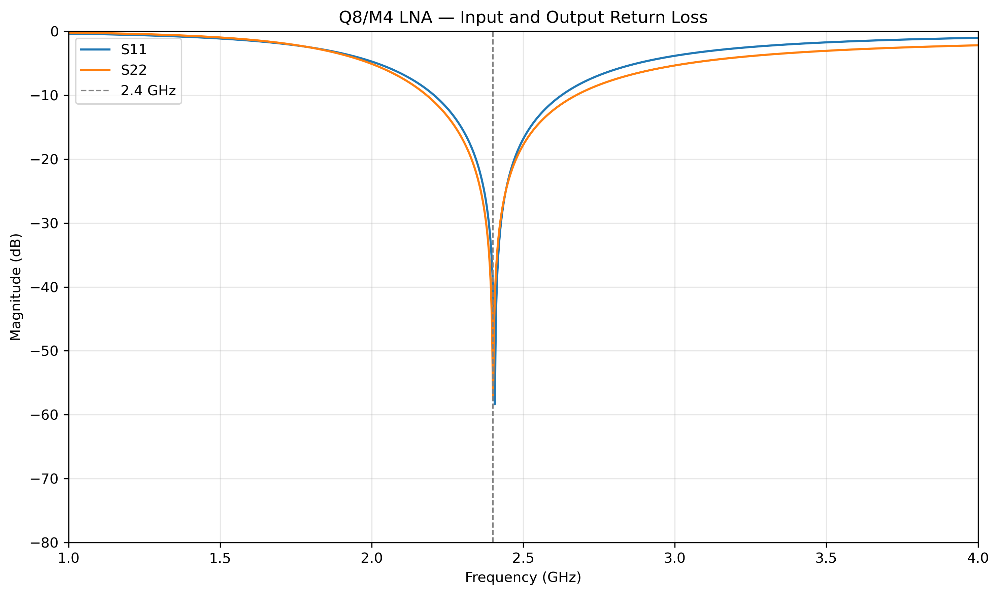
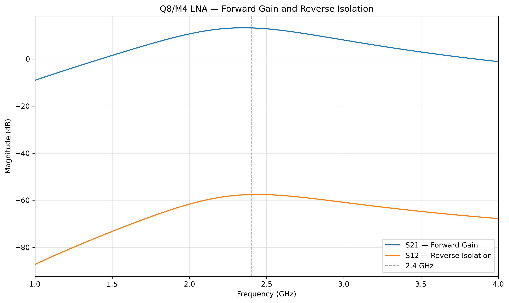
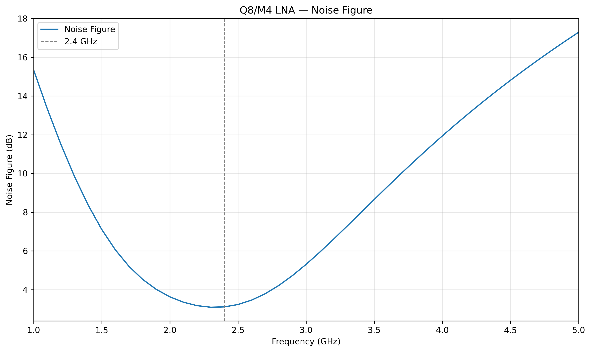
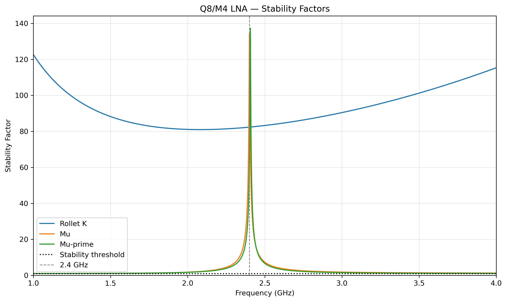
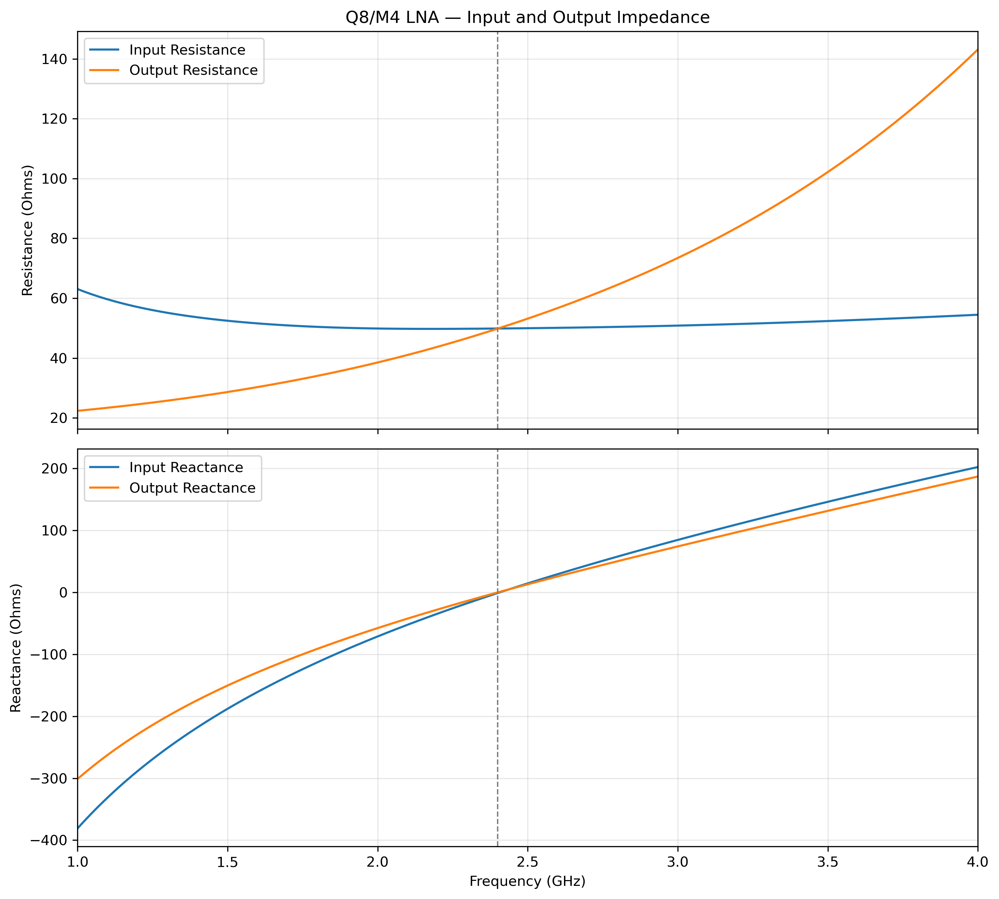

# SKY130A LNA — Q8/M4 Design

## Simulation setup
- PDK: SKY130A
- Simulator: ngspice
- Supply: 1.8 V
- Operating frequency: 2.4 GHz
- S-parameter sweep: 1–4 GHz, 3001 points
- Noise sweep: 1–5 GHz, 41 points
- Schematic: `schematic/lna_q8_m4.sch`

## S-parameters and impedance at 2.4 GHz

| Parameter | Simulated value |
|---|---:|
| S11 | -39.90756 dB |
| S21 | 13.23085 dB |
| S12 | -57.56603 dB |
| S22 | -56.94001 dB |
| Input resistance | 49.88529 ohm |
| Input reactance | -1.003053 ohm |
| Output resistance | 49.85797 ohm |
| Output reactance | 0.000133 ohm |
| Rollet K | 82.35687 |
| Mu | 134.0660 |
| Mu-prime | 61.83248 |
| Noise figure | 3.108142 dB |

## Bandwidth measurements

- S11 below -10 dB: 2.205763–2.626415 GHz (420.652 MHz)
- S22 below -10 dB: 2.181283–2.674552 GHz (493.269 MHz)
- S21 within 3 dB of sweep maximum: 1.972299–2.797408 GHz (825.109 MHz)

## DC power

- Supply voltage: 1.8 V
- Supply current: approximately 2.518 mA
- DC power: approximately 4.53 mW

## Large-signal power sweep

IIP3/OIP3 values are gain-compression estimates, not two-tone simulation results.

| Pin (dBm) | Pout (dBm) | Gain (dB) | Gain change (dB) | IIP3 estimate (dBm) | OIP3 estimate (dBm) | Pdc (W) | Efficiency |
|---:|---:|---:|---:|---:|---:|---:|---:|
| -50 | -36.7779 | 13.2221 | -0.00878363 | -20.0464 | -6.8155 | 0.00453255 | 4.63308e-05 |
| -30 | -16.7884 | 13.2116 | -0.0193425 | -3.47215 | 9.75875 | 0.00456011 | 0.00459389 |
| -20 | -6.88815 | 13.1119 | -0.119047 | -1.33932 | 11.8916 | 0.00482087 | 0.0424678 |
| -18 | -4.95793 | 13.0421 | -0.188825 | -1.32534 | 11.9056 | 0.00498972 | 0.0639929 |
| -16 | -3.08024 | 12.9198 | -0.31114 | -1.46386 | 11.767 | 0.0052534 | 0.093656 |
| -15 | -2.17723 | 12.8228 | -0.408128 | -1.61819 | 11.6127 | 0.00543395 | 0.111471 |
| -14 | -1.31787 | 12.6821 | -0.548768 | -1.86927 | 11.3616 | 0.00565285 | 0.130601 |
| -13 | -0.52139 | 12.4786 | -0.75229 | -2.18899 | 11.0419 | 0.00591199 | 0.150013 |
| -12 | 0.194808 | 12.1948 | -1.03609 | -2.50939 | 10.7215 | 0.00620883 | 0.16845 |
| -11 | 0.81904 | 11.819 | -1.41186 | -2.76159 | 10.4693 | 0.00653757 | 0.184709 |
| -10 | 1.35148 | 11.3515 | -1.87942 | -2.89071 | 10.3402 | 0.00689414 | 0.198001 |
| -9 | 1.80654 | 10.8065 | -2.42436 | -2.86582 | 10.3651 | 0.00728176 | 0.20817 |
| -8 | 2.20063 | 10.2006 | -3.03027 | -2.69111 | 10.5398 | 0.00770094 | 0.215536 |
| -6 | 2.83097 | 8.83097 | -4.39993 | -1.99267 | 11.2382 | 0.00861793 | 0.222686 |

## Data files

- `results/data/lna_q8_m4/q8_m4_sparams.dat`
- `results/data/lna_q8_m4/q8_m4_nf.dat`
- `results/data/lna_q8_m4/q8_m4_power_sweep.csv`
- `results/data/q8_m4_export.log`
- `results/netlists/lna_q8_m4.spice`

## Plots

