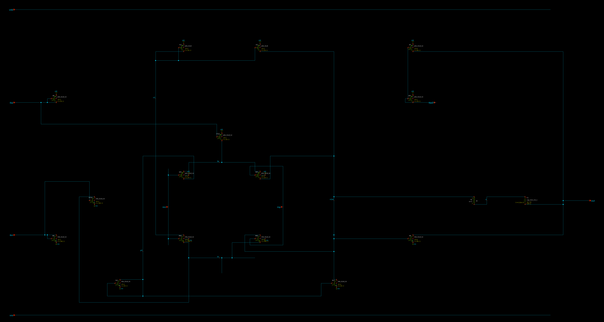
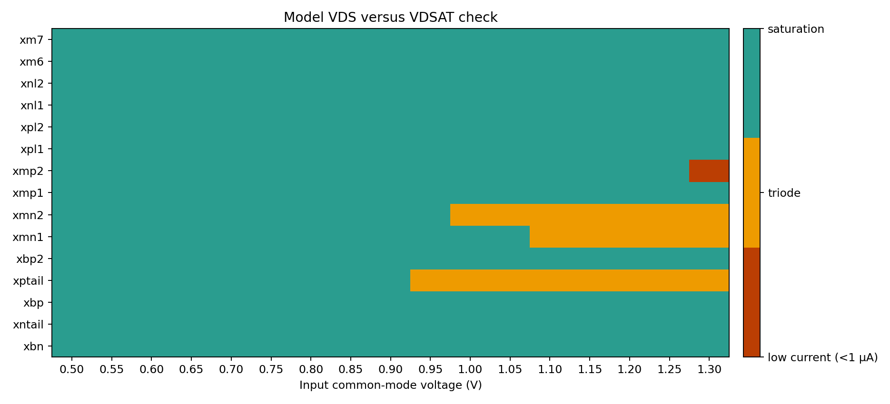

# SKY130 Two-Stage Op-Amp

A complementary-input, two-stage op-amp designed and simulated in the SKY130A process using ngspice.
Simulation only — not fabricated, not tapeout-ready.

## Schematic

Complementary NMOS/PMOS input pairs with current-mirror loads, a common-source second stage, and
Miller compensation (resistor + MIM cap). An earlier version used folded-cascode devices; I dropped
that for the current-mirror version in the final design.

[Schematic source](final_delivery/final/opamp_rri.sch)

## Results

| What I checked | Target | What I got | Result |
|---|---|---|---|
| DC gain | ≥60 dB | 70.8–73.7 dB | Pass |
| Unity-gain bandwidth | ≥10 MHz | 11.1–13.2 MHz | Pass |
| Phase margin | ≥60° | 77.7–80.0° | Pass |
| Power | <500 µW | 317–325 µW | Pass |
| Slew rate (rising) | ≥10 V/µs | 3.67–3.72 V/µs | Fail |
| Slew rate (falling) | ≥10 V/µs | 6.60–6.86 V/µs | Fail |
| ICMR | 0.5–1.3 V | Works 0.5–0.9 V, 9/17 points pass | Partial |
| Output swing (DC) | 0.3–1.5 V | All 9 points pass, within 2.9 mV | Pass |
| Noise | No spec set | 124.9 µV out / 720.8 µV input-referred, 1 Hz–1 GHz | Measured, no target |

Gain, bandwidth, phase margin and power all pass across TT/SS/FF corners and five common-mode points
(0.45–0.85 V) — 15 combinations, all good. Slew rate and the full ICMR range don't meet spec.

## Where ICMR actually breaks

I swept 17 points from 0.5 to 1.3 V. It's solid from 0.5 to 0.9 V, then fails starting at 0.95 V — the
PMOS tail device drops out of saturation there (VDS = 0.229 V vs. its VDSAT of 0.259 V). So the
0.5–1.3 V target isn't met, but at least I know exactly why.

## Noise — why the input-referred number looks "wrong" but isn't

This was a closed-loop unity-follower test. At low frequency the loop gain is close to 1, so output
noise and input-referred noise look almost identical (both ~56 nV/√Hz at 1 kHz). Above the